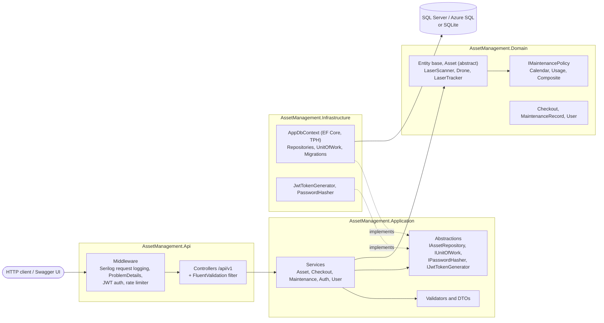

# Asset Management REST API

An ASP.NET Core 8 Web API for tracking high-value field equipment such as terrestrial laser scanners, survey drones and laser trackers. Technicians check equipment out and back in, log maintenance and calibration, and the API enforces the business rules: you can't check out an asset that is already out, under maintenance, retired or overdue for service, and each kind of equipment has its own maximum loan period. The project follows Clean Architecture with a rich domain model, JWT authentication with role-based authorization, FluentValidation, RFC 7807 ProblemDetails errors, API versioning, rate limiting and structured logging. Unit and integration tests cover all of these.

## Features

- **Assets CRUD** with server-side **pagination, filtering** (type, status, location, free-text search) and **whitelisted sorting**. Deleting an asset retires it and keeps its history.
- **Polymorphic domain model.** An abstract `Asset` has `LaserScanner`, `Drone` and `LaserTracker` subtypes. Each subtype supplies its own **maintenance policy** (calendar, usage-based or a composite strategy) and its **maximum checkout duration**.
- **Checkout / return workflow** with business rules enforced inside the aggregate. A database-level filtered unique index allows only one open checkout per asset, and an optimistic-concurrency stamp guards against two requests changing the same asset at once.
- **Maintenance records** (preventive, corrective, calibration). Completing maintenance resets the service counters and puts the asset back into circulation.
- **JWT bearer authentication**: register, login and `me` endpoints. Passwords are hashed with ASP.NET Core Identity's `PasswordHasher` (PBKDF2).
- **Role-based authorization** with three roles: `Viewer` (read), `Technician` (checkout and maintenance) and `Admin` (assets and users). Every endpoint requires authentication unless it is explicitly marked anonymous.
- **FluentValidation** for every request, returned as `ValidationProblemDetails`.
- **Global exception middleware** that maps errors to **ProblemDetails** with a `traceId` and a stable error `code` (for example `asset.already_checked_out`).
- **API versioning** in the route (`/api/v1/...`) via `Asp.Versioning`.
- **Swagger / OpenAPI** with an **Authorize** button for JWTs and XML-doc descriptions.
- **Serilog** structured console logging and request logging.
- **Rate limiting** with the built-in ASP.NET Core limiter: a per-user (or per-IP) fixed window, a stricter quota on login and register, and `429` responses with `Retry-After`.
- **Health check** at `/health`, including a database probe.
- **Configurable database provider**: SQLite for local development and tests, SQL Server / Azure SQL in production (with EF Core migrations).

## Tech stack

| Area | Technology |
| --- | --- |
| Runtime | .NET 8, ASP.NET Core 8 Web API (controllers) |
| Data | Entity Framework Core 8 with SQL Server / Azure SQL and SQLite providers |
| Auth | JWT bearer (`Microsoft.AspNetCore.Authentication.JwtBearer`), ASP.NET Core Identity `PasswordHasher` |
| Validation | FluentValidation 11 |
| API | Asp.Versioning 8, Swashbuckle 6 (OpenAPI) |
| Observability | Serilog, ASP.NET Core health checks |
| Testing | xUnit, Moq, FluentAssertions 6, `Microsoft.AspNetCore.Mvc.Testing` (`WebApplicationFactory`), `FakeTimeProvider` |
| Delivery | Docker (multi-stage, non-root), docker-compose, GitHub Actions |

## Architecture

The dependencies point inwards. The domain has no dependencies at all. The application layer defines use cases and the interfaces it needs, such as repositories, unit of work, password hashing and token issuing. Infrastructure implements those interfaces, and the API is a thin HTTP adapter.



Key design decisions:

- **Business rules live in the aggregate.** `Asset.CheckOut`, `Return`, `StartMaintenance`, `CompleteMaintenance` and `Retire` guard every state transition and throw `DomainException` with a machine-readable code. The services only orchestrate loading, calling the domain and saving.
- **Polymorphism instead of `switch` statements.** "Is maintenance due?" and "how long can this be borrowed?" are virtual members that each asset type answers for itself through an `IMaintenancePolicy` strategy.
- **Time is injected.** Services use .NET 8's `TimeProvider`, so tests control the clock with `FakeTimeProvider`.
- **Table-per-hierarchy mapping.** All asset types share one `Assets` table with an `AssetType` discriminator. Enums are stored as strings to keep the database readable.

## Project structure

```
asset-management-api/
├── src/
│   ├── AssetManagement.Domain/          # Entities, asset hierarchy, maintenance policies, domain errors
│   ├── AssetManagement.Application/     # Services, DTOs, validators, repository/security abstractions
│   ├── AssetManagement.Infrastructure/  # EF Core DbContext, configurations, repositories, migrations, JWT, hashing
│   └── AssetManagement.Api/             # Controllers, middleware, auth policies, rate limiting, Swagger, Program.cs
├── tests/
│   ├── AssetManagement.UnitTests/       # Domain rules, services (Moq), validators
│   └── AssetManagement.IntegrationTests/# WebApplicationFactory + SQLite end-to-end HTTP tests
├── .github/workflows/ci.yml             # Build, test and Docker image build
├── Directory.Build.props                # net8.0, nullable, warnings as errors
├── Directory.Packages.props             # Central NuGet version pinning
├── Dockerfile
└── docker-compose.yml                   # API + SQL Server 2022 for local use
```

## Running locally

### Option 1: .NET SDK with SQLite (no other dependencies)

Prerequisite: the [.NET 8 SDK](https://dotnet.microsoft.com/download/dotnet/8.0).

```bash
dotnet restore
dotnet run --project src/AssetManagement.Api --launch-profile http
```

- Swagger UI: http://localhost:5080/swagger
- The Development environment creates `assets.db` (SQLite), seeds sample equipment and creates a **development-only** admin account, `admin@example.com` / `DevOnly-Passw0rd!` (configured in `appsettings.Development.json`).

### Option 2: Docker Compose with SQL Server

```bash
docker compose up --build
```

This starts SQL Server 2022 and the API on http://localhost:8080 (Swagger at `/swagger`). On startup the API applies the EF Core migrations. Every password and key in `docker-compose.yml` (for example `Your_strong_password123`) is a local-only example.

> The Dockerfile and compose file are included for convenience but were **not** built or run in the environment where this project was developed. The automated test suite runs against SQLite only (see below).

### Configuration

| Setting | Purpose | Default |
| --- | --- | --- |
| `Database:Provider` | `Sqlite` or `SqlServer` | `Sqlite` |
| `ConnectionStrings:DefaultConnection` | Connection string for the chosen provider | `Data Source=assets.db` |
| `Jwt:Issuer` / `Jwt:Audience` | Token issuer and audience | `asset-management-api` / `asset-management-clients` |
| `Jwt:SigningKey` | HMAC-SHA256 key, at least 32 characters | **dev-only placeholder** |
| `Jwt:ExpiryMinutes` | Access token lifetime | `60` |
| `RateLimiting:*` | Global and auth permit limits and windows | 100/min global, 10/min auth |
| `Swagger:Enabled` | Serve Swagger outside Development | `false` |
| `Seed:AdminEmail` / `Seed:AdminPassword` / `Seed:SampleData` | Optional bootstrap data | off |

> **Signing key:** the key in `appsettings.json` is a development placeholder. In production, supply `Jwt:SigningKey` from **Azure Key Vault** (or a secure app setting). The API refuses to start in the `Production` environment if it detects the placeholder key.

### Database migrations (SQL Server)

Migrations target SQL Server / Azure SQL and are applied automatically at startup when `Database:Provider=SqlServer`. SQLite databases (dev and tests) are created directly from the model. To add a migration:

```bash
dotnet tool restore
dotnet ef migrations add <Name> \
  --project src/AssetManagement.Infrastructure \
  --startup-project src/AssetManagement.Infrastructure \
  --output-dir Persistence/Migrations
```

## Running the tests

```bash
dotnet test
```

- **Unit tests** (`tests/AssetManagement.UnitTests`) cover domain rules and maintenance policies, application services with Moq and `FakeTimeProvider`, and the FluentValidation rules.
- **Integration tests** (`tests/AssetManagement.IntegrationTests`) boot the real API in-process with `WebApplicationFactory<Program>`, using a throw-away SQLite file per fixture. They exercise registration and login, tampered and missing tokens, the role matrix, CRUD with paging, filtering and sorting, the checkout and maintenance workflows (including the `409` business-rule responses), ProblemDetails bodies, versioning headers, the health check and `429` rate limiting.

**What is not covered:** the tests do not run against SQL Server. The SQL Server provider configuration and the generated migration compile and are used by the Docker setup, but no automated test executes them against a real SQL Server instance.

## API reference

All routes are prefixed with `/api/v1`. Errors are returned as `application/problem+json`.

| Method | Route | Role | Description | Success |
| --- | --- | --- | --- | --- |
| `POST` | `/auth/register` | anonymous (rate limited) | Create an account (role `Viewer`) and return a token | `201` |
| `POST` | `/auth/login` | anonymous (rate limited) | Exchange credentials for a JWT | `200` |
| `GET` | `/auth/me` | any authenticated | Current user's profile | `200` |
| `GET` | `/assets` | Viewer+ | List assets: `page`, `pageSize` (max 100), `search`, `type`, `status`, `location`, `includeRetired`, `sortBy` (`name`, `serialNumber`, `manufacturer`, `status`, `type`, `createdAt`, `lastServicedAt`), `sortDirection` (`Asc`/`Desc`) | `200` |
| `GET` | `/assets/{id}` | Viewer+ | Get one asset | `200` |
| `POST` | `/assets` | Admin | Register an asset (type-specific spec field required) | `201` |
| `PUT` | `/assets/{id}` | Admin | Update details and specifications | `200` |
| `DELETE` | `/assets/{id}` | Admin | Retire (soft-delete) an asset | `204` |
| `POST` | `/assets/{id}/checkout` | Technician+ | Check the asset out to the caller | `201` |
| `POST` | `/assets/{id}/return` | Technician+ | Return the asset | `200` |
| `GET` | `/assets/{id}/checkouts` | Viewer+ | Checkout history | `200` |
| `GET` | `/checkouts/overdue` | Technician+ | All open checkouts past their due date | `200` |
| `GET` | `/assets/{id}/maintenance` | Viewer+ | Maintenance history | `200` |
| `POST` | `/assets/{id}/maintenance` | Technician+ | Start maintenance (asset becomes unavailable) | `201` |
| `POST` | `/assets/{id}/maintenance/{recordId}/complete` | Technician+ | Complete maintenance | `200` |
| `GET` | `/users` | Admin | List users | `200` |
| `PUT` | `/users/{id}/role` | Admin | Change a user's role | `200` |
| `GET` | `/health` (no prefix) | anonymous | Liveness and database check | `200` |

Common error responses: `400` validation, `401` missing, invalid or expired token, `403` insufficient role, `404` unknown resource, `409` business-rule violation or conflict (with `code`), `429` rate limited.

### Business rules

| Rule | Error code |
| --- | --- |
| An asset that is already checked out cannot be checked out again | `asset.already_checked_out` |
| An asset under maintenance cannot be checked out | `asset.under_maintenance` |
| A retired asset cannot be checked out or edited | `asset.retired` |
| An asset overdue for service under its maintenance policy cannot be checked out | `asset.maintenance_overdue` |
| The loan period cannot exceed the type's maximum: Drone 3 days, Laser scanner 14, Laser tracker 30 | `checkout.duration_exceeded` |
| Maintenance cannot start while an asset is checked out | `asset.checked_out` |
| Serial numbers and user emails are unique | `asset.duplicate_serial_number`, `user.duplicate_email` |

| Asset type | Maintenance policy |
| --- | --- |
| `LaserScanner` | every 365 days **or** every 50 checkouts |
| `Drone` | every 90 days **or** every 20 checkouts |
| `LaserTracker` | calibration every 180 days |

### Sample requests

```bash
BASE=http://localhost:5080

# Log in as the development admin and capture the token
TOKEN=$(curl -s -X POST $BASE/api/v1/auth/login \
  -H "Content-Type: application/json" \
  -d '{"email":"admin@example.com","password":"DevOnly-Passw0rd!"}' | jq -r .accessToken)

# Register a drone
curl -s -X POST $BASE/api/v1/assets \
  -H "Authorization: Bearer $TOKEN" -H "Content-Type: application/json" \
  -d '{"type":"Drone","name":"Survey Drone Charlie","serialNumber":"UAV-M350-0003",
       "manufacturer":"DJI","model":"Matrice 350 RTK","location":"Hyderabad Depot",
       "maxFlightTimeMinutes":55}'

# Page 1 of available drones, sorted by name (descending)
curl -s "$BASE/api/v1/assets?type=Drone&status=Available&sortBy=name&sortDirection=Desc&page=1&pageSize=10" \
  -H "Authorization: Bearer $TOKEN"

# Check an asset out for two days, then return it
ASSET_ID=<asset-id>
curl -s -X POST $BASE/api/v1/assets/$ASSET_ID/checkout \
  -H "Authorization: Bearer $TOKEN" -H "Content-Type: application/json" \
  -d "{\"dueAtUtc\":\"$(date -u -d '+2 days' +%FT%TZ)\",\"notes\":\"Bridge survey\"}"
curl -s -X POST $BASE/api/v1/assets/$ASSET_ID/return -H "Authorization: Bearer $TOKEN"

# Start and complete a calibration
RECORD_ID=$(curl -s -X POST $BASE/api/v1/assets/$ASSET_ID/maintenance \
  -H "Authorization: Bearer $TOKEN" -H "Content-Type: application/json" \
  -d '{"type":"Calibration","description":"Six-monthly calibration"}' | jq -r .id)
curl -s -X POST $BASE/api/v1/assets/$ASSET_ID/maintenance/$RECORD_ID/complete \
  -H "Authorization: Bearer $TOKEN" -H "Content-Type: application/json" \
  -d '{"cost":450.00,"resolutionNotes":"Within tolerance"}'
```

Example business-rule error:

```json
{
  "type": "https://tools.ietf.org/html/rfc9110#section-15.5.10",
  "title": "Business rule violation",
  "status": 409,
  "detail": "Asset 'RTC-360-0001' is already checked out.",
  "instance": "POST /api/v1/assets/a8c4.../checkout",
  "traceId": "0HNQ3T5RU2Q6J:00000001",
  "code": "asset.already_checked_out"
}
```

## Azure deployment notes

This project has not been deployed to Azure. A production setup would look like this:

- **Hosting:** Azure App Service for Containers or Azure Container Apps, running the Docker image from Azure Container Registry. The container listens on port `8080`, and TLS terminates at the platform ingress.
- **Database:** Azure SQL Database with `Database__Provider=SqlServer`. Prefer **Managed Identity** (`Authentication=Active Directory Default` in the connection string) over SQL logins. Migrations run at startup; for multi-instance deployments, consider applying them from the release pipeline instead (`dotnet ef migrations bundle`).
- **Secrets:** store `Jwt--SigningKey` (and any connection string secrets) in **Azure Key Vault** and surface them through Key Vault references in App Service settings or Container Apps secrets. Never commit real keys.
- **Observability:** Serilog writes structured logs to stdout, which App Service and Container Apps collect. You can add the Application Insights sink or OpenTelemetry exporter for distributed tracing.
- **Health:** point the platform health probe at `/health`.
- **Scale-out:** the built-in rate limiter is in-memory and per instance. Behind multiple instances, enforce global limits at Azure API Management or Front Door.

## License

[MIT](LICENSE) © Prasad Ramineni
